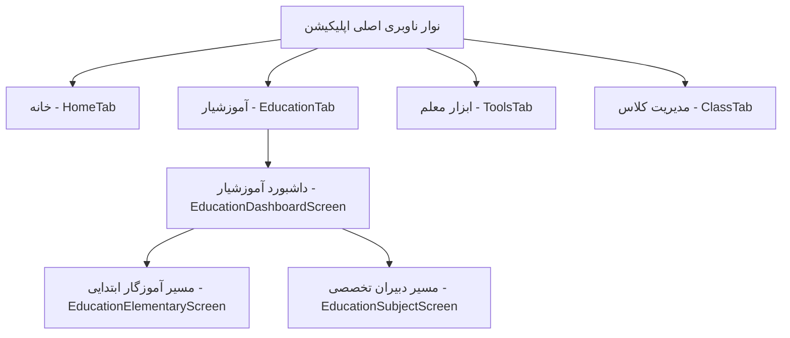
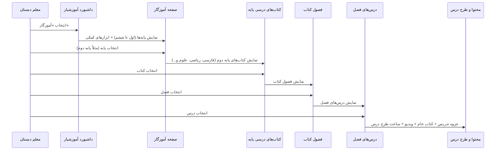
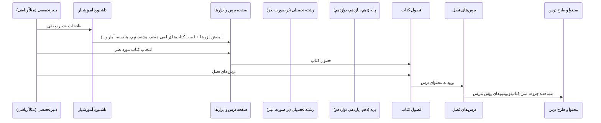
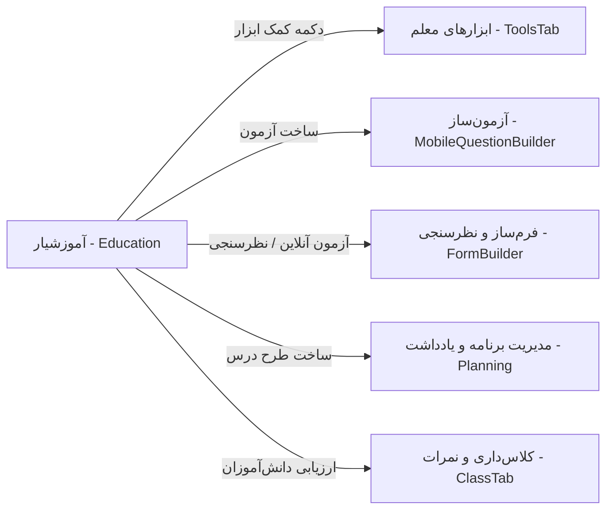

# مستند جامع و راهنمای ساختار بخش «آموزشیار» (پلتفرم کیتایار)

> **خلاصه:** بخش آموزشیار (`EducationTab`) یکی از ارکان چهارگانه پلتفرم کیتایار در اپلیکیشن موبایل است که به عنوان دستیار هوشمند تدریس، مرجع محتوای کتب درسی و پیوندگاه ابزارهای کمک‌آموزشی برای معلمان عمل می‌کند.

---

## ۱. فلسفه و هدف اصلی آموزشیار (Philosophy & Objectives)

بخش **آموزشیار** با هدف پاسخ به دغدغه‌های روزمره معلمان در کلاس درس و پیش از ورود به کلاس طراحی شده است:

1. **حذف نیاز به حمل کتب فیزیکی و جزوات سنگین:** معلم در هر لحظه به متن کامل کتاب‌ها، سرفصل‌ها، و جزوات راهنمای تدریس در گوشی خود دسترسی دارد.
2. **هدایت ساختاریافته فرآیند تدریس (Pedagogical Blueprint):** ایجاد یک سلسله‌مراتب استاندارد از کلان به خرد:
   $$\text{تخصص/مقطع} \longrightarrow \text{پایه/رشته} \longrightarrow \text{کتاب درسی} \longrightarrow \text{فصل} \longrightarrow \text{درس} \longrightarrow \text{محتوای یاددهی}$$
3. **پیوند مستقیم محتوا با آزمون‌سازی و ابزارهای کلاس:** دسترسی سریع به ساخت آزمون، برگزاری آزمون آنلاین و ابزارهای کاربردی متناسب با همان درس.
4. **توسعه حرفه‌ای معلم (Teacher Professional Development):** ارائه نکات کلیدی متدولوژی تدریس و ویدیوهای روش تدریس اساتید برتر.
5. **تسهیل تدوین طرح درس:** امکان تبدیل سریع محتوای هر درس به طرح درس روزانه و سالانه.

---

## ۲. جایگاه در معماری ناوبری اپلیکیشن

آموزشیار دومین تب اصلی از نوار ناوبری پایینی اپلیکیشن (`MainTabNavigator`) است:

---

## ۳. دسته‌بندی موضوعی و تخصص‌های معلمان

در صفحه داشبورد اصلی (`EducationDashboardScreen`)، ۱۶ تخصص معلمی در قالب کارت‌های ۳ ستونه با رنگ‌بندی و آیکون‌های متناسب تفکیک شده‌اند:

| ردیف | عنوان تخصص | مقطع / ماهیت | فلو و صفحه مقصد |
| :--- | :--- | :--- | :--- |
| **۱** | **آموزگار** | ابتدایی (پایه‌های ۱ تا ۶) | `EducationElementaryScreen` (فلو پایه‌محور) |
| **۲** | **دبیر ریاضی** | متوسطه اول و دوم | `EducationSubjectScreen` (فلو کتاب‌محور) |
| **۳** | **دبیر علوم** | متوسطه اول | `EducationSubjectScreen` |
| **۴** | **دبیر فیزیک** | متوسطه دوم | `EducationSubjectScreen` |
| **۵** | **دبیر شیمی** | متوسطه دوم | `EducationSubjectScreen` |
| **۶** | **دبیر زیست** | متوسطه دوم | `EducationSubjectScreen` |
| **۷** | **دبیر فارسی** | متوسطه اول و دوم | `EducationSubjectScreen` |
| **۸** | **دبیر عربی** | متوسطه اول و دوم | `EducationSubjectScreen` |
| **۹** | **دبیر انگلیسی** | متوسطه اول و دوم | `EducationSubjectScreen` |
| **۱۰** | **مطالعات اجتماعی** | متوسطه اول | `EducationSubjectScreen` |
| **۱۱** | **دبیر تاریخ** | متوسطه دوم | `EducationSubjectScreen` |
| **۱۲** | **دبیر جغرافیا** | متوسطه دوم | `EducationSubjectScreen` |
| **۱۳** | **دینی و قرآن** | دوره‌های مختلف | `EducationSubjectScreen` |
| **۱۴** | **کار و فناوری** | دوره‌های مختلف | `EducationSubjectScreen` |
| **۱۵** | **دبیر هنر** | دوره‌های مختلف | `EducationSubjectScreen` |
| **۱۶** | **تربیت بدنی** | دوره‌های مختلف | `EducationSubjectScreen` |

---

## ۴. مسیرهای کاربری (User Journeys)

آموزشیار برای دو گروه از معلمان دو مسیر کاملاً متناسب با ساختار آموزشی کشور فراهم کرده است:

### مسیر اول: آموزگار ابتدایی (پایه‌محور)
معلم دبستان تدریس تمام دروس یک پایه را بر عهده دارد؛ بنابراین ساختار آن ابتدا بر اساس **پایه** چیده شده است:

### مسیر دوم: دبیران تخصصی و متوسطه (درس‌محور و رشته‌محور)
دبیران متوسطه بر یک درس مشخص تمرکز دارند و ممکن است در چندین پایه یا رشته تدریس کنند:

---

## ۵. تشریح صفحات و اجزای داخلی آموزشیار

### ۱. داشبورد آموزشیار (`EducationDashboardScreen.tsx`)
- **هدر و عنوان صفحه:** نوار هدر استاندارد همراه با دسترسی به پروفایل.
- **شبکه موضوعی (۳ ستونه):** کارت‌های نرم با گوشه‌های گرد، بک‌گراند تطبیقی روشن/تاریک، پالت رنگی متمایز و آیکون‌های وکتور `Lucide`.

### ۲. صفحه مقطع ابتدایی (`EducationElementaryScreen.tsx`)
- **بخش ابزارهای کاربردی (Top Bar Tools):**
  - 🛠️ **کمک ابزار کلاسی:** اتصال سریع به ابزارهای معلم (تایمر، قرعه‌کشی، حضور و غیاب).
  - ✍️ **ساخت آزمون:** اتصال مستقیم به ماژول آزمون‌ساز کیتایار.
  - 📡 **برگزاری آزمون آنلاین:** هدایت به سامانه آزمون‌های آنلاین و فرم‌ساز.
- **لیست پایه‌های تدریس:** کارت‌های افقی با آیکون کلاه فارغ‌التحصیلی از پایه اول تا ششم با فلش هدایتگر.

### ۳. صفحه تخصص موضوعی (`EducationSubjectScreen.tsx`)
- نمایش عنوان و تم رنگی اختصاصی همان درس.
- بخش ابزارهای کاربردی ۳ گانه بالای صفحه.
- لیست کارت‌های کتب درسی شامل کاور تصویر کتاب، نام کتاب و برچسب پایه (مثلاً «ریاضی ۱ - دهم ریاضی و تجربی»).

### ۴. صفحه انتخاب رشته و پایه (`EducationFieldScreen.tsx` & `EducationGradeScreen.tsx`)
- برای دروسی که نیازمند تفکیک دوره‌های متوسطه دوم هستند (ریاضی و فیزیک، علوم تجربی، ادبیات و علوم انسانی).
- گزینش پایه‌های دهم، یازدهم و دوازدهم با نوار نشانی (Breadcrumbs) برای آگاهی کاربر از موقعیت خود در سلسله‌مراتب.

### ۵. صفحه فصول کتاب (`EducationChaptersScreen.tsx`)
- نوار ناوبری متنی (Breadcrumbs): مسیر طی‌شده شامل پایه و عنوان کتاب.
- شماره‌گذاری گرافیکی فصول در دایره‌های شناور اختصاصی.
- عنوان دقیق هر فصل بر اساس کتاب رسمی آموزش و پرورش.

### ۶. صفحه درس‌های فصل (`EducationLessonsScreen.tsx`)
- تفکیک هر فصل به درس‌های مربوطه (مثلاً فصل ۱: درس ۱: مجموعه‌های متناهی، درس ۲: متمم مجموعه و...).
- آیکون سند متنی و نمایش زیرعنوان سرفصل درس.

### ۷. هسته محتوای آموزشی (`EducationLessonContentScreen.tsx`)
این صفحه مقصد نهایی معلم است که ۳ رکن آموزشی را ارائه می‌دهد:
1. **تب جزوه (`notes`):**
   - متن توجیهی و آموزشی تدریس.
   - نکات کلیدی متدولوژی آموزشی.
   - کادرهای برجسته پیشنهاد و هشدارهای پداگوژیک (مثال‌های مناسب/نامناسب کلاسی).
2. **تب کتاب خام (`book`):**
   - تصویر اسلایس یا متن عینی کتاب درسی جهت ارجاع سریع حین تدریس.
3. **تب ویدیو (`video`):**
   - ویدیوهای روش تدریس همراه با مدت زمان، تامبنیل باکیفیت و دکمه پخش.
4. **دکمه شناور پایینی (FAB):**
   - دکمه برجسته **«ساخت طرح درس»** با آیکون `+` جهت نگارش یا تولید طرح درس با هوش مصنوعی برای همان درس.

---

## ۶. پیوند با سایر ماژول‌های کیتایار (Ecosystem Integration)

آموزشیار یک ماژول ایزوله نیست، بلکه هسته ارتباطی اجزای مختلف کیتایار است:

---

## ۷. ساختار فنی و مدل‌های داده‌ای بک‌اند

در لایه پایگاه داده بک‌اند کیتایار (`backend/src/core/models/`)، ساختار رابطه‌ای متناظر به شرح زیر آماده است:

* `Subject.ts`: موضوعات و تخصص‌های درسی (ریاضی، فیزیک، زیست و...).
* `Field.ts`: رشته‌های تحصیلی (تجربی، ریاضی، انسانی، عمومی).
* `Grade.ts`: پایه‌های تحصیلی (اول تا دوازدهم).
* `Book.ts`: مشخصات کتاب‌ها، ارجاع به پایه، ترتیب و تعداد سوالات بانک سوال.
* `Question.ts`: بانک سوالات متصل به هر کتاب و فصل.

---

## ۸. نقشه راه و پیشنهادات توسعه (Roadmap)

| فاز | موضوع | شرح توسعه |
| :---: | :--- | :--- |
| **فاز ۱** | **پویایی داده‌ها (Dynamic Data)** | جایگزینی آرایه‌های ماک محلی با فراخوانی API بک‌اند (`GET /api/education/books` و `/lessons`). |
| **فاز ۲** | **تکمیل مدیا پلیر** | فعال‌سازی پلیر ویدیوی بومی کیتایار (`KitayarVideoPackage`) برای پخش آنلاین ویدیوهای تدریس داخل اپ. |
| **فاز ۳** | **دستیار هوش مصنوعی طرح درس** | با کلیک روی «ساخت طرح درس»، هوش مصنوعی بر اساس اهداف کتاب طرح درس روزانه را آماده کند. |
| **فاز ۴** | **دانلود آفلاین کتاب‌ها** | امکان کش کردن یا دانلود PDF فصول جهت استفاده معلمان در مدارس بدون اینترنت. |
| **فاز ۵** | **اتصال به بانک سوالات درس** | افزودن تب چهارم به صفحه درس به عنوان «بانک سوالات این درس» برای دسترسی فوری به نمونه سوالات امتحانی. |
