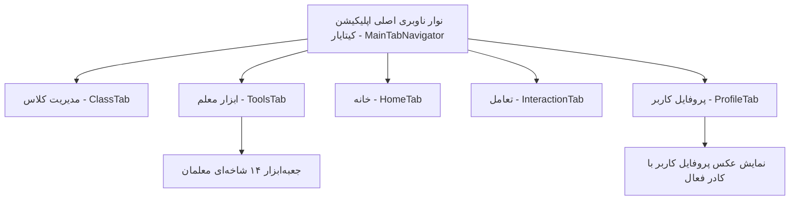

# مستند جامع معماری ناوبری، «ابزار معلم» و «بخش پروفایل» (پلتفرم کیتایار)

> **نسخه مستند:** ۲.۰.۰  
> **مخاطبان:** توسعه‌دهندگان، مدیران محصول، طراحان تجربه کاربری و کادر آموزشی  
> **محل فایل:** `kitayar/docs/teacher_tools_and_profile_guide.md`  
> **تغییرات کلیدی این نسخه:**
> ۱. حذف کامل بخش «آموزشیار» و صفحات متناظر با آن از اپلیکیشن.  
> ۲. افزودن تب «پروفایل» به نوار ناوبری پایینی (Bottom Navigation) همراه با نمایش تصویر آواتار معلم به جای آیکون معمولی.  
> ۳. حذف بخش پروفایل از تمام هدرها (`GlobalHeader`) و انتقال یکپارچه آن به نوار ناوبری اصلی.

---

# ۱. معماری ناوبری اصلی اپلیکیشن (`MainTabNavigator`)

در ساختار جدید، نوار ناوبری پایینی اپلیکیشن شامل ۵ تب کلیدی و استاندارد است:



### مشخصات و آرایش تب‌ها:
1. **مدیریت کلاس (`ClassTab`):** دسترسی به مدارس، لیست کلاس‌ها، لیست دانش‌آموزان، ثبت حضور و غیاب و نمرات کلاسی (با آیکون `Users`).
2. **ابزار معلم (`ToolsTab`):** جعبه‌ابزار ۱۴ شاخه‌ای همه‌فن‌حریف شامل آزمون OMR، وایت‌برد، ابزارهای PDF، سنسورها، ماشین‌حساب‌ها، ریموت و نواها (با آیکون `Wrench`).
3. **خانه (`HomeTab`):** داشبورد مرکزی، برنامه‌ریزی روزانه، تقویم جلالی، اعلانات و ابزارک اوقات شرعی (با آیکون `Home`).
4. **تعامل (`InteractionTab`):** تالار گفتمان همکاران، پرسش و پاسخ‌های کلاسی و تبادل تجربه معلمان (با آیکون `MessageCircle`).
5. **پروفایل (`ProfileTab`):** بخش جامع اطلاعات معلم، پست‌ها و محتوای آموزشی، رزومه و سوابق، تیکت پشتیبانی و تنظیمات (با **عکس واقعی پروفایل معلم**).

---

# ۲. بازطراحی هدر سراسری (`GlobalHeader`)

مطابق با نیازمندی جدید، بخش پروفایل (آواتار، نام کاربر و کلیک ورود به پروفایل) به طور کامل از هدرهای برنامه حذف گردید تا ناوبری به طور اختصاصی از طریق تب جدید پایینی صورت پذیرد:

```
┌────────────────────────────────────────────────────────────────┐
│  [کیتایار]                                             [🔔 ۱]  │
│  شنبه ۵ آبان ۱۴۰۳                                             │
└────────────────────────────────────────────────────────────────┘
```
- **سمت راست (شروع در راست‌چین):** نام برند «کیتایار» با تایپوگرافی اختصاصی به همراه تاریخ روز شمسی یا زیرعنوان راهنما.
- **سمت چپ (پایان):** دکمه دسترسی به اعلانات و پیام‌ها همراه با نشانگر عددی (Badge) پیام‌های خوانده‌نشده.

---

# ۳. تشریح جامع بخش پروفایل (`ProfileScreen`)

با انتقال پروفایل به عنوان یکی از تب‌های اصلی، معلم به امکانات زیر دسترسی دارد:

### ۳.۱ هویت بصری و آواتار
- **آیکون تب در نوار پایینی:** به جای آیکون برداری متداول، تصویر پروفایل کاربر به صورت دایره‌ای با ابعاد استاندارد نمایش داده می‌شود. در وضعیت فعال (Focused)، کادری برجسته با رنگ اصلی سیستم (`colors.primary`) دور عکس نمایان می‌شود.
- **بنر کاور و نشان تأیید معلم رسمی:** کاور لینکدینی در بالای صفحه همراه با تیک آبی تأیید صلاحیت آموزشیار آموزش و پرورش.

### ۳.۲ آمار و کارت‌های عملکرد معلم
- تعداد پست‌های منتشرشده در تالار تعامل.
- تعداد کل دانش‌آموزان تحت پوشش.
- تعداد کلاس‌های فعال.
- سابقه رسمی تدریس (بر حسب سال).

### ۳.۳ تب‌های سه‌گانه پروفایل
1. **پست‌ها (`posts`):** آرشیو ویدیوها و تصاویر تدریس خلاقانه، کارگاه‌های علمی و تجلیل از دانش‌آموزان با امکان درج پست جدید و اشتراک‌گذاری.
2. **رزومه و سوابق (`resume`):**
   - سوابق شغلی و تدریس در مدارس مختلف با بازه زمانی.
   - تحصیلات دانشگاهی، رشته و مدارک علمی.
   - مهارت‌های تدریس فعال، بازی‌وارسازی و آزمون‌سازی.
3. **یادداشت‌ها و برنامه‌ها (`notes`):** دسترسی سریع به نکات شخصی و برنامه‌های معلم.

### ۳.۴ منوی عملیات و تنظیمات
- امکان ویرایش نام، شماره تلفن، مدرسه و بیوگرافی.
- ارسال تیکت و پیام مستقیم به پشتیبانی کیتایار (`SupportTicketsScreen`).
- اطلاعات تماس و راه‌های ارتباطی در شبکه‌های اجتماعی (ایتا و تلگرام).
- خروج امن از حساب کاربری (با دیالوگ تأیید دو مرحله‌ای).

---

# ۴. دانشنامه کامل امکانات «ابزار معلم» (Teacher Tools)

بخش ابزار معلم به عنوان یکی از ارکان کاربردی اپلیکیشن، شامل ۱۴ شاخه اصلی زیر است:

## ۴.۱ سیستم‌های آزمون و ارزشیابی هوشمند
1. **مدیریت آزمون آنلاین:** فلو ۲ مرحله‌ای ساخت آزمون آنلاین، تعیین مهلت، نمره منفی، تصادفی‌سازی گزینه‌ها، تصحیح خودکار تستی و نمره‌دهی تشریحی با ثبت در دفتر کلاس.
2. **برگه آزمون‌ساز چاپی دستی (`MobileQuestionBuilder`):** تولید سربرگ رسمی مدارس، قالب‌های سوالات چندگزینه‌ای، تشریحی، صحیح/غلط و جای خالی، بارم‌بندی و خروجی تمیز PDF آماده چاپ A4.
3. **پاسخ‌برگ هوشمند و تصحیح تصویری OMR (`SmartSheetHubScreen`):** تولید پاسخ‌برگ‌های چهارگوشه‌دار استاندارد، اسکن حباب‌های تستی با دوربین گوشی به صورت آفلاین، بازبینی دستی گزینه‌های نامشخص، و صدور کارنامه آنی.

## ۴.۲ فرم‌ساز و پرسش‌نامه تعاملی کلاسی (`FormDashboardScreen`)
- ساخت انواع فرم با فیلدهای متن کوتاه، پاسخ بلند، چندگزینه‌ای، منوی کشویی، ماتریس رضایت‌سنجی لیکرت، تاریخ شمسی و آپلود تصویر.
- قالب‌های آماده رضایت‌نامه اردو، نظرسنجی اولیا و ثبت‌نام رویدادها.
- نمودارهای آماری تحلیلی و خروجی اکسل نتایج.

## ۴.۳ جعبه‌ابزار جامع فایل و اسناد (`ToolsListScreen`)
- **ابزارهای تصویر:** اسکنر اوراق با اصلاح زاویه و پرسپکتیو، کاهش حجم تصاویر جهت بارگذاری در شاد، تغییر ابعاد، برش، کلاژ و تبدیل فرمت‌های عکس.
- **تبدیل اسناد:** تبدیل عکس به PDF و بالعکس، تبدیل Word، Excel، PowerPoint و متون به PDF.
- **ویرایشگر حرفه‌ای PDF (`AdvancedPdfScreen`):** ادغام (Merge)، فشرده‌سازی (Compress)، تقسیم (Split)، جداسازی صفحات، حذف صفحات، تغییر ترتیب، چرخش ۹۰/۱۸۰ درجه، افزودن واترمارک متنی و رمزگذاری اسناد.
- **صوت و ویدیو:** برش ویدیوهای تدریس، استخراج صوت از فیلم (Video to Audio) و تایپ صوتی فارسی (صوت به متن).

## ۴.۴ تخته وایت‌برد و بوم بی‌نهایت (`InfiniteCanvasScreen`)
- بوم بی‌پایان با زوم و جابه‌جایی نامحدود.
- انواع قلم، براش، ماژیک هایلایتر و پاک‌کن هوشمند.
- رسم اشکال هندسی (خط، فلش، دایره، مستطیل، مثلث).
- درج متن فارسی و تصاویر کمکی روی تخته.
- پس‌زمینه‌های شطرنجی، خط‌دار و ساده، مدیریت لایه‌ها و صدور فایل عکس.

## ۴.۵ ابزارهای ورزشی و پویایی کلاسی
- کرنومتر صدم‌ثانیه ورزشی با قابلیت ثبت دورها (Laps).
- تایمر تمرین و اینتروال کلاسی با آلارم‌های صوتی.
- شمارشگر ست و تکرار حرکات ورزشی.
- گردونه شانس انتخاب تصادفی دانش‌آموز جهت پرسش کلاسی.
- گروه‌بندی و تیم‌بندی خودکار دانش‌آموزان به گروه‌های همگن.

## ۴.۶ سنسورها و ابزارهای آزمایشگاهی هوشمند
- قبله‌نما با محاسبه ماهواره‌ای فاصله و زاویه کعبه.
- قطب‌نما و تراز مهندسی ۳ جهته دیجیتال.
- صداسنج (دسی‌بل‌متر) جهت نظارت بر آرامش کلاس.
- نورسنج (لوکس‌متر) جهت بررسی استاندارد روشنایی محیط کلاس و درس علوم.
- نقاله و زاویه‌سنج تعاملی روی تصویر زنده دوربین.
- لرزه‌نگار و زلزله‌سنج با شتاب‌سنج گوشی جهت مباحث زمین‌شناسی.

## ۴.۷ ماشین‌حساب‌های جامع کلاسی (بیش از ۵۰ فرمول)
- فرمول‌های درصد، افزایش/کاهش، تخفیف، قیمت قبل و بعد تخفیف.
- محاسبه میانگین، معدل وزنی، نمره نهایی مستمر+پایانی و نمره تستی با نمره منفی کنکوری.
- مساحت و محیط اشکال هندسی (مربع، مستطیل، مثلث، دایره، ذوزنقه، متوازی‌الاضلاع، لوزی).
- حجم مکعب، مکعب‌مستطیل، استوانه، مخروط و کره.
- شاخص توده بدنی (BMI)، سرعت دویدن، مسافت، زمان، ریتم گام (Pace) و ضربان قلب هدف.
- سود و زیان، سود ساده و مرکب بانکی، و اقساط وام صندوق مدرسه.
- تبدیل مبناهای ۲، ۸، ۱۰، ۱۶، تبدیل عدد به حروف فارسی و اعداد رومی.

## ۴.۸ سیستم جامع تبدیل واحد (۱۲ کمیت)
- طول، وزن، حجم، مساحت، دما، زمان، سرعت، فشار، انرژی، توان، فرکانس و زاویه با دکمه جابه‌جایی سریع مبدأ و مقصد.

## ۴.۹ ابزارهای محاسباتی دروس تخصصی
- فیزیک (سرعت، شتاب، نیرو، وزن، چگالی، کار، توان، قانون اهم و توان الکتریکی).
- شیمی (مول، جرم مولی، تبدیل گرم به مول، مولاریته، درصد جرمی و محاسبه pH).
- ریاضیات (لگاریتم در مبناهای مختلف، فاکتوریل).
- زیست‌شناسی (برون‌ده قلبی).

## ۴.۱۰ ابزارهای تاریخ و تقویم
- محاسبه سن دقیق (سال، ماه، روز و روز هفته تولد + روزهای باقیمانده تا تولد بعدی).
- محاسبه دقیق اختلاف زمانی بین دو تاریخ.
- تبدیل تقویم (شمسی، میلادی، قمری).
- محاسبه روزهای کاری و کل بین دو تاریخ.

## ۴.۱۱ بارکد و کدهای QR کلاسی
- ساخت QR Code برای لینک‌ها، کانال‌های شاد، وای‌فای مدرسه و کارت تماس با تم‌های رنگی زیبا.
- ساخت بارکدهای خطی استاندارد.
- بارکدخوان سریع با دوربین و ذخیره تاریخچه.

## ۴.۱۲ ریموت کنترل سخت‌افزاری IR
- کنترل ویدیو پروژکتور، کولرهای اسپلیت و تلویزیون کلاس درس با حسگر مادون قرمز گوشی به همراه ویزارد جفت‌سازی برندهای مختلف.

## ۴.۱۳ رسانه، نواها و قرآن کریم
- قرآن کریم دیجیتال با ۱۱۴ سوره، خط عثمان‌طه، ترجمه و صوت آیه به آیه.
- اوقات شرعی آفلاین ۳۱ استان و بیش از ۱۰۰۰ شهر ایران.
- پلیر سراسری سرود صبحگاه، سرود ملی و زنگ‌های تفریح.

## ۴.۱۴ دفترچه تلفن سازمانی مدارس
- فهرست ادارات آموزش و پرورش، شماره‌های ضروری و مدارس با قابلیت تماس مستقیم درون‌برنامه‌ای.

---

> **پایان مستند**  
> تمامی ارجاعات این ساختار در اپلیکیشن نهایی اعمال شده و فایل مستند در مسیر `kitayar/docs/teacher_tools_and_profile_guide.md` در دسترس است.
